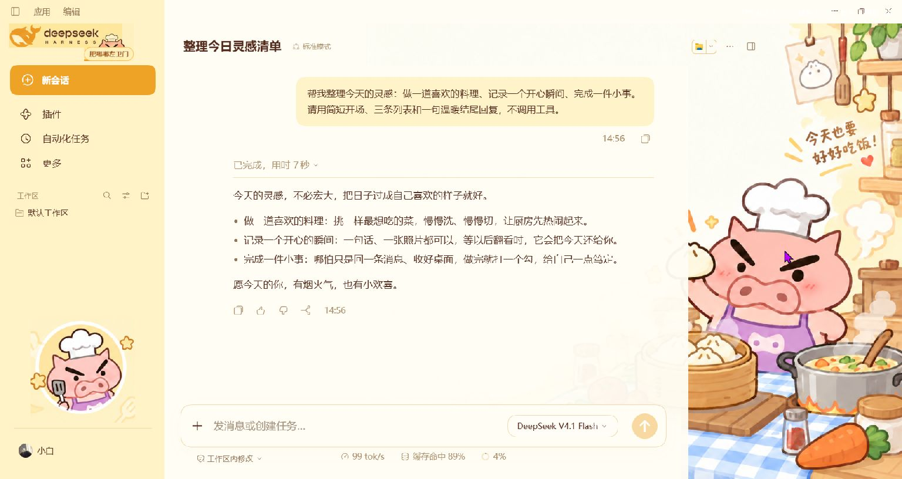

# 肥嘟嘟左卫门 · 暖黄厨房

DeepSeek Harness 桌面主题 v1.0.0，依据所选“今天也要好好吃饭”设计图制作。奶油黄侧栏、厨房场景、厨师左卫门与原生无头像聊天。

## 图片预览



上图拍摄于白边修正前，用于展示整体配色、插画和无头像聊天布局。当前版本已将阅读区硬边改为渐隐过渡；按用户要求，修正后未再做实机检查或重新截图。


上图为设计参考，不是实机截图。

## 安装

在 DSH **插件 → 添加插件**中填写：

```text
https://github.com/dingfz-cyber/dsh-theme-buriburizaemon-kitchen
```

停用其他整套主题，再启用 **肥嘟嘟左卫门·暖黄厨房**。也可下载 Release ZIP，解压后填写直接包含 package.json 的目录完整路径。该目录需长期保留。仓库含 lib/，无需自行构建。

## 布局

宽窗口为右侧厨房插画预留空间，用户消息靠右，助手正文沿用原生无头像排版。窄窗口优先阅读和输入，背景适当淡化。模型、工作区、附件、发送、停止、滚动与侧栏拖动使用原生功能。

参考图为 1489 × 1056。系统栏、原生功能入口、真实消息长度和窗口比例会影响排版，实际界面采用自适应布局。

## 当前验收

2026-10-25 已完成构建，并在 Windows DSH 0.2.1-rc.3 中运行。此前已操作侧栏拖宽缩窄、真实无头像对话、模型菜单、720 字草稿、右侧面板以及主题停用和重新启用。此前自动验证为 8 项通过、0 失败。

最终白边渐隐修正已重新构建，按用户要求未继续实机检查，不将其描述为复测通过。深色模式、其他系统和其他 DSH 版本未验证。详情见 [制作记录](design-qa.md)。

## 开发

Node.js 20+：

```sh
npm run build
npm run check
npm run verify
```

## 素材说明

非官方同人主题，角色、第三方商标和参考素材的权益归各自权利人所有。见 LICENSE。
